<div align="center">


<br/>

**A modern, animated digital-marketing agency landing page built with Next.js, React and Tailwind CSS.**

<p>
  
  
  
  
</p>
<p>
  
  
  
  
  
</p>

[Overview](#-overview) •
[Demo](#-live-demo) •
[Screenshots](#-screenshots) •
[Features](#-features) •
[Tech stack](#-tech-stack) •
[Getting started](#-getting-started) •
[Structure](#-project-structure) •
[Customising](#-customising)

</div>

---

## 📖 Overview

**Digital** is a single-page landing site for a creative and digital-marketing agency. It started as a static HTML/CSS site and was **migrated to Next.js (App Router)**. The look matches the original exactly, and the page is now built from typed, reusable React components styled with Tailwind CSS v4.

The page leads visitors from a bold hero, through the agency's services, stats and portfolio, to a clear **"Ready to get started?"** call to action. Motion throughout comes from entrance animations, scroll parallax and a masonry portfolio grid.

> [!NOTE]
> The copy is placeholder text (*Lorem ipsum*). Swap in your own content in the files under [`components/`](components/).

---

## 🎬 Live demo

<div align="center">
  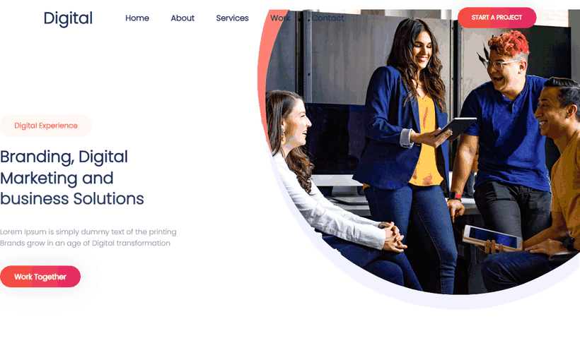
  <br/>
  <sub>The hero entrance animation, then a full scroll-through of the page.</sub>
</div>

---

## 📸 Screenshots

### Hero

<p align="center">
  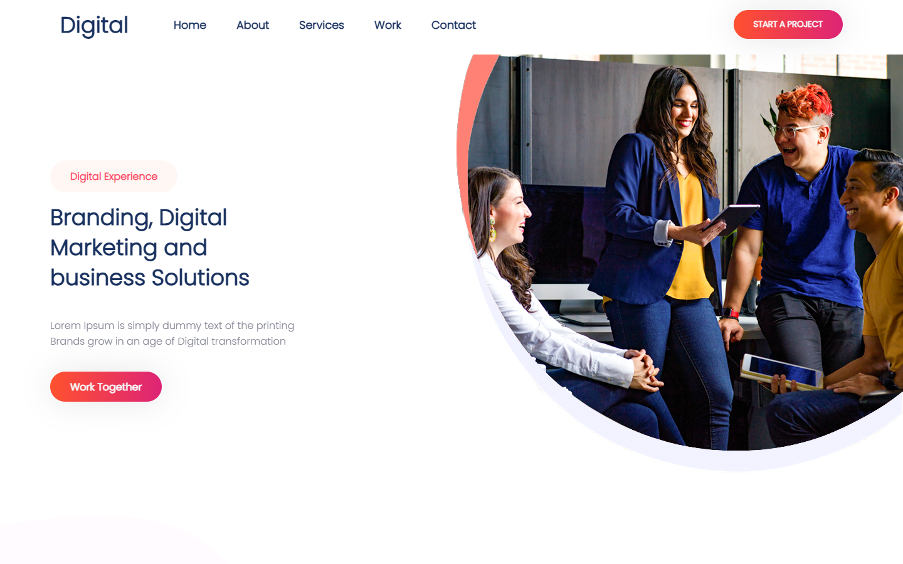
</p>

### Sections

<table>
  <tr>
    <td width="50%" align="center">
      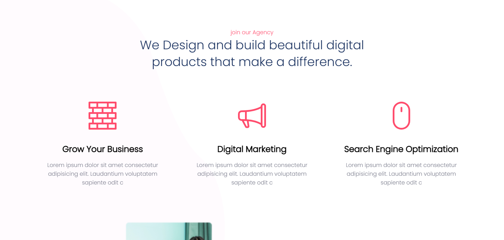
      <br/><b>Join our Agency</b>: three core services
    </td>
    <td width="50%" align="center">
      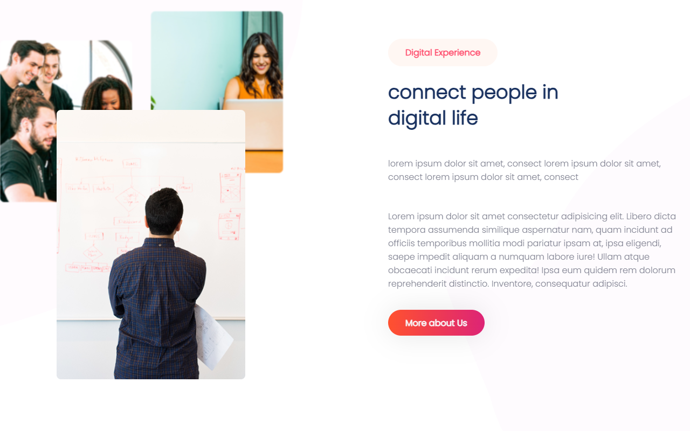
      <br/><b>Digital Life</b>: layered parallax image collage
    </td>
  </tr>
  <tr>
    <td width="50%" align="center">
      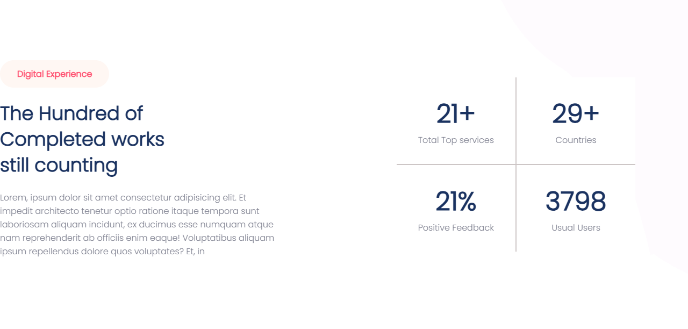
      <br/><b>Still Counting</b>: stats grid
    </td>
    <td width="50%" align="center">
      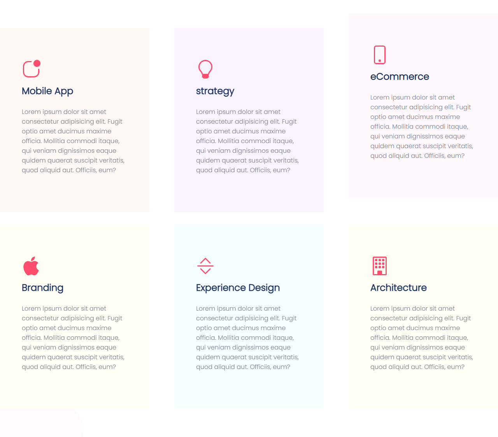
      <br/><b>Services</b>: six pastel service cards
    </td>
  </tr>
  <tr>
    <td width="50%" align="center">
      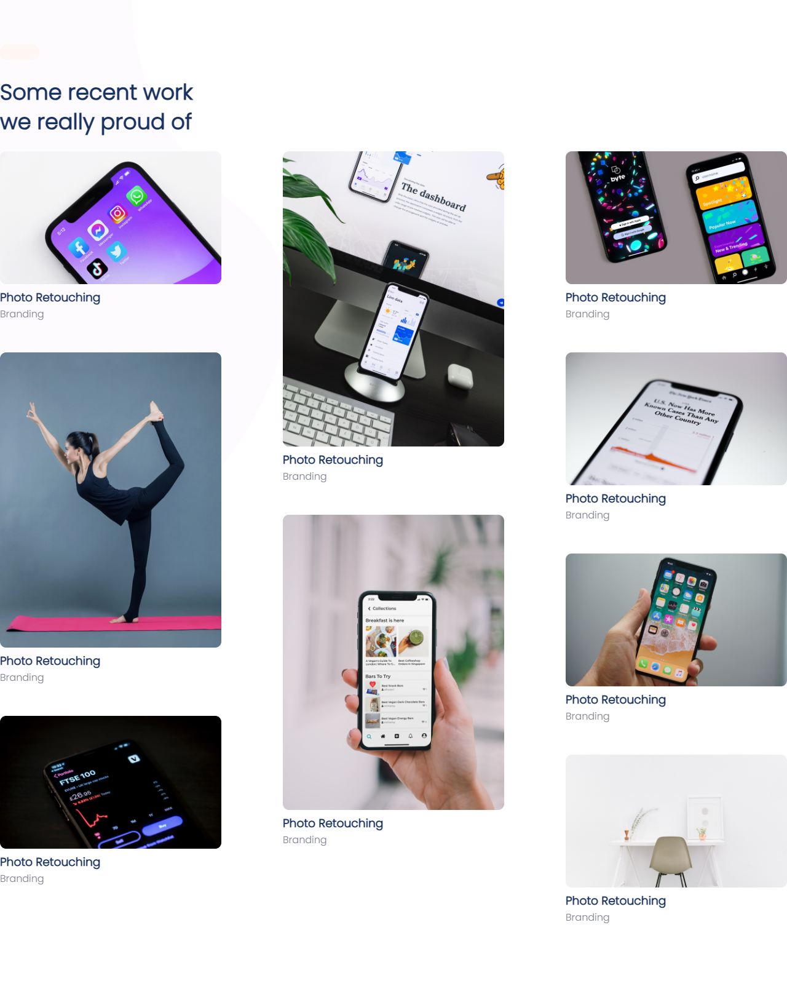
      <br/><b>Recent Work</b>: Masonry portfolio
    </td>
    <td width="50%" align="center">
      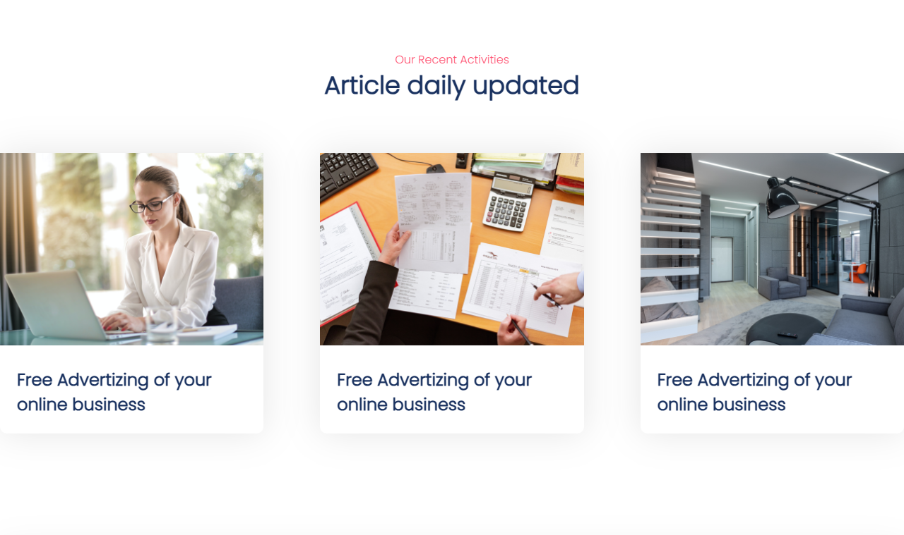
      <br/><b>Articles</b>: daily-updated blog cards
    </td>
  </tr>
  <tr>
    <td width="50%" align="center">
      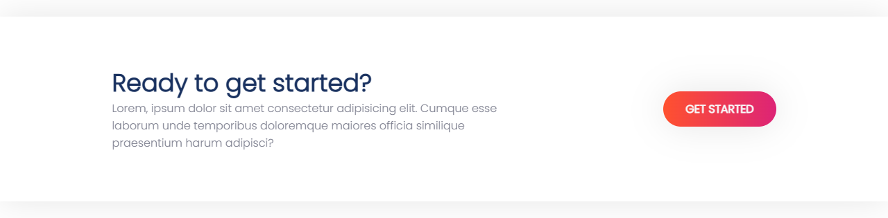
      <br/><b>Call to Action</b>: "Ready to get started?"
    </td>
    <td width="50%" align="center">
      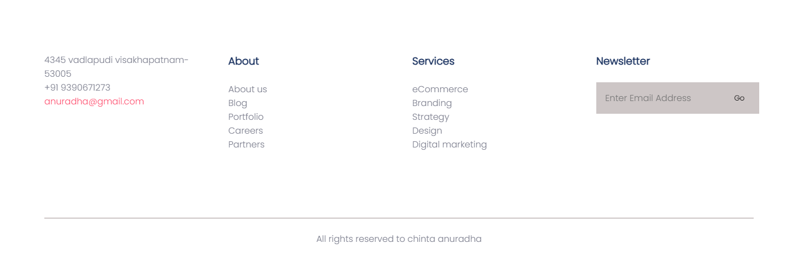
      <br/><b>Footer</b>: links and newsletter signup
    </td>
  </tr>
</table>

### Mobile

<p align="center">
  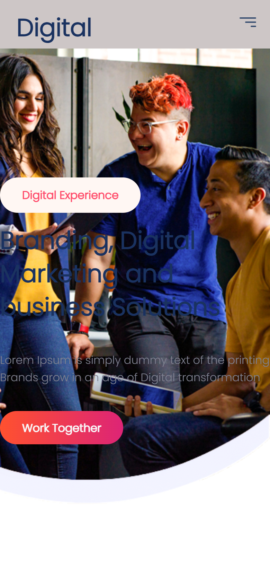
</p>

<details>
<summary><b>🖼️ Full-page screenshot</b> (click to expand)</summary>
<br/>
<p align="center">
  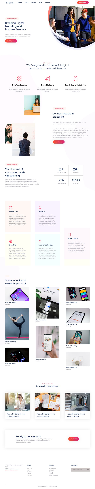
</p>
</details>

---

## ✨ Features

| | Feature | Details |
|---|---|---|
| 🎞️ | **Entrance animations** | Staggered `fadeInDown` hero headline, plus `fadeInLeft`, `fadeInRight`, `fadeInUp` and `zoomIn` reveals, all from [animate.css](https://animate.style/) |
| 🌊 | **Scroll parallax** | Image collage and service cards move at different speeds using [Rellax](https://dixonandmoe.com/rellax/) (`data-rellax-speed`) |
| 🧱 | **Masonry portfolio** | A nine-item portfolio laid out by [masonry-layout](https://masonry.desandro.com/), re-laid out as each image finishes loading |
| 📱 | **Responsive layout** | Mobile-first Tailwind grids that switch from one column to two or three at the `md` and `lg` breakpoints |
| 🍔 | **Collapsible navigation** | Hamburger toggle with an animated `max-height` transition and `aria-expanded` state |
| 🎨 | **Design tokens** | Colours, type scale, gradients and shadows defined once in Tailwind v4's `@theme` |
| ⚡ | **Static generation** | The whole page is prerendered at build time (`○ Static`) for fast loads and easy hosting |
| 🔤 | **Optimised fonts** | Poppins served locally through `next/font/google`, with no layout shift |
| 🧩 | **Typed components** | Each section is its own small, data-driven TypeScript component |

---

## 🛠 Tech stack

| Layer | Technology |
|---|---|
| Framework | [Next.js 16](https://nextjs.org/) (App Router) |
| UI library | [React 19](https://react.dev/) |
| Language | [TypeScript](https://www.typescriptlang.org/) |
| Styling | [Tailwind CSS v4](https://tailwindcss.com/) via `@tailwindcss/postcss` |
| Animation | [animate.css](https://animate.style/) · [Rellax](https://github.com/dixonandmoe/rellax) |
| Layout | [masonry-layout](https://masonry.desandro.com/) |
| Icons | [react-icons](https://react-icons.github.io/react-icons/) (Bootstrap Icons set) |
| Font | [Poppins](https://fonts.google.com/specimen/Poppins) via `next/font` |

---

## 🚀 Getting started

### Prerequisites

- **Node.js 20.9 or later**
- npm (bundled with Node)

### Installation

```bash
# 1. Clone the repository
git clone https://github.com/anuradha-2907/DigitalMarketing.git
cd DigitalMarketing

# 2. Install dependencies
npm install

# 3. Start the dev server
npm run dev
```

Then open **<http://localhost:3000>** in your browser.

### Available scripts

| Command | Description |
|---|---|
| `npm run dev` | Start the development server with hot reload |
| `npm run build` | Create an optimised production build |
| `npm run start` | Serve the production build (run `build` first) |

---

## 📂 Project structure

```text
DigitalMarketing/
├── app/
│   ├── layout.tsx          # Root layout: Poppins font, animate.css, page background
│   ├── page.tsx            # Assembles the landing page from section components
│   └── globals.css         # Tailwind v4 import, @theme design tokens, gradients
├── components/
│   ├── Header.tsx          # Logo, nav links, mobile toggle, "Start a project" CTA  (client)
│   ├── Banner.tsx          # Hero with staggered fadeInDown headline
│   ├── AgencyArea.tsx      # "Join our Agency": three service highlights
│   ├── LifeArea.tsx        # "Connect people in digital life": parallax collage
│   ├── CountingArea.tsx    # "Still counting": stats grid
│   ├── CardArea.tsx        # Six service cards (one with parallax)
│   ├── RecentWork.tsx      # Masonry portfolio grid  (client)
│   ├── ArticleArea.tsx     # Article / blog cards
│   ├── ReadyArea.tsx       # "Ready to get started?" CTA
│   ├── Footer.tsx          # Address, link columns, newsletter
│   └── Parallax.tsx        # Starts Rellax on every .rellax element  (client)
├── lib/
│   └── styles.ts           # Shared Tailwind class strings (buttons, pill, heading)
├── types/
│   └── vendor.d.ts         # Type declarations for masonry-layout and rellax
├── public/assets/          # Images: hero, collage, portfolio, articles, background
├── docs/                   # README banner and screenshots
├── next.config.ts
├── postcss.config.mjs
└── tsconfig.json
```

### Page composition

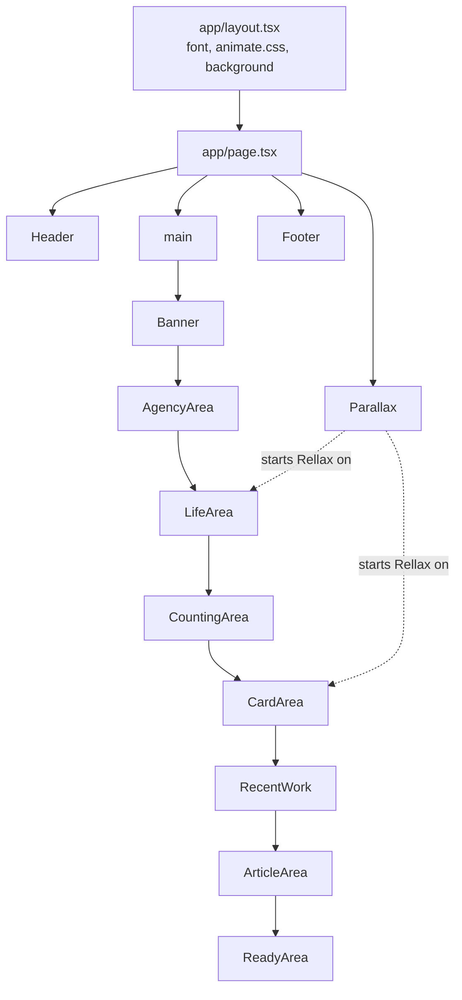

<details>
<summary><b>🔍 How the animations work</b></summary>
<br/>

**1. Entrance animations (animate.css)**
`animate.css` is imported once in [`app/layout.tsx`](app/layout.tsx). Components add classes such as `animate__animated animate__fadeInDown`. The hero staggers its three headline lines with `animate__faster` and `animate__fast` modifiers.

**2. Parallax (Rellax)**
Any element with the `rellax` class and a `data-rellax-speed` attribute gets a parallax effect. [`components/Parallax.tsx`](components/Parallax.tsx) is a client component that loads `rellax` with a dynamic `import()` on mount, so it never runs on the server, and destroys the instance on unmount.

**3. Masonry grid**
[`components/RecentWork.tsx`](components/RecentWork.tsx) loads `masonry-layout` on the client (the library touches `window` when it is imported). It re-runs the layout on every image `load` event so items never overlap.

**4. Mobile navigation**
[`components/Header.tsx`](components/Header.tsx) toggles a `max-height` between `0` and `50vh` with a `0.9s` CSS transition, and exposes the state through `aria-expanded`.

</details>

---

## 🎨 Customising

All design tokens live in the `@theme` block of [`app/globals.css`](app/globals.css):

| Token | Value | Used for |
|---|---|---|
| `--color-dark` |  | Headings and logo |
| `--color-red` |  | Accents, icons, eyebrow text |
| `--color-gray` |  | Body copy |
| `bg-gradient` |  →  | Primary buttons |
| `bg-gradient-indigo` |  →  | Button hover |

- **Content:** each section keeps its data in a small array at the top of its component (for example `services` in `AgencyArea.tsx`, `stats` in `CountingArea.tsx` and `cards` in `CardArea.tsx`).
- **Images:** replace the files in [`public/assets/`](public/assets/) and keep the same names.
- **Shared button styles:** edit [`lib/styles.ts`](lib/styles.ts).

---

## ☁️ Deployment

The page is fully static, so it can be deployed anywhere Next.js runs:

- **[Vercel](https://vercel.com/new):** import the repository; no configuration is needed.
- **Any Node host:** `npm run build && npm run start`.

---

## 🐞 Known issues

- **The mobile menu opens but its links are hidden.** On small screens the header box is a fixed `70px` tall with `overflow-y: hidden`, so the expanded link list is clipped. Letting the header grow when the menu is open (for example `h-auto` instead of `h-[70px]` below `lg`) would fix it.

---

## 🗺 Roadmap ideas

- [ ] Fix the mobile navigation clipping
- [ ] Replace placeholder copy and add real portfolio links
- [ ] Wire up the newsletter form
- [ ] Trigger entrance animations on scroll (Intersection Observer) instead of on load
- [ ] Add `alt` text to all images and run an accessibility audit
- [ ] Add a `LICENSE` file

---

## 👩‍💻 Author

**Chinta Anuradha**: [@anuradha-2907](https://github.com/anuradha-2907)

If you find this project useful, please consider giving it a ⭐ on GitHub!

<div align="center">
  <br/>
  
</div>
